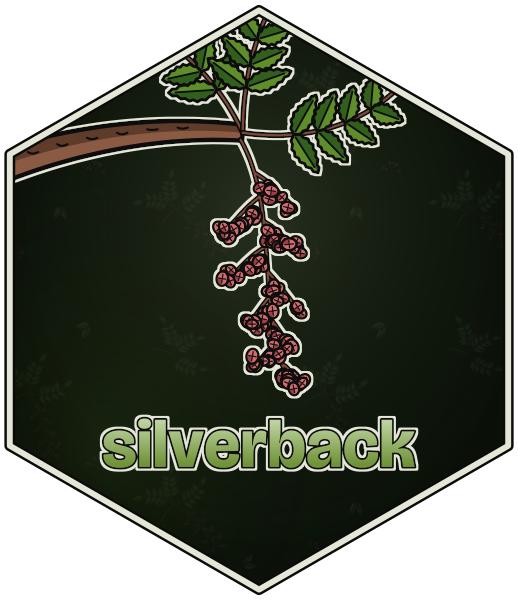

# silverback 

<!-- badges: start -->
[](https://github.com/mcanzi/silverback/actions/workflows/R-CMD-check.yaml)
<!-- badges: end -->

silverback reads the data downloaded from the [Gorilla Experiment Builder](https://gorilla.sc/) and turns it into <span class="hl">tidy tibbles</span>. A Gorilla export has one row per event, dozens of metadata columns, marker rows, an `END OF FILE` line and a different layout for each task and questionnaire builder. silverback sorts this into three tibbles: responses in tasks, answers to questionnaires and one row per participant.

It reads

- Task Builder 1 and Task Builder 2 data,
- Questionnaire Builder 1 and Questionnaire Builder 2 data, in long and short format,
- downloads with <span class="hl">one file per node</span> and <span class="hl">combined downloads</span>,
- several versions of an experiment at once,
- CSV and Excel downloads,
- folders, single files and ZIP archives as downloaded, also after CSV files were saved again with semicolons or tabs,
- recordings of the Eye Tracking (Webgazer) and Mouse Tracking components of Task Builder 2.

Files from nodes that no participant reached are skipped.

## Installation

silverback is not on CRAN yet. Install it from GitHub:

```r
# install.packages("pak")
pak::pak("mcanzi/silverback")
```

## Example

The package includes a small invented experiment with a lexical decision task (Task Builder 2), a rhyme judgement task (Task Builder 1), a consent form (Questionnaire Builder 1) and a background questionnaire (Questionnaire Builder 2).

```r
library(silverback)

g <- read_gorilla(gorilla_example())
g
#> <gorilla_data> experiment 123456, version 3
#> 6 participants
#>   complete: 5, live: 1
#> Tasks:
#>   Lexical decision (Task Builder 2): 6 participants
#>   Rhyme judgement (Task Builder 1): 5 participants
#> Questionnaires:
#>   Background: 7 items, 6 participants
#>   Consent: 2 items, 6 participants
#> 1 empty file skipped
```

`gorilla_trials()` keeps one row per response and gives both task builders the same columns, followed by the timing, spreadsheet and store columns of the task:

```r
gorilla_trials(g, task = "Lexical decision")
```

`gorilla_wide()` gives one row per participant and one column per questionnaire item. Items with a <span class="hl">quantised value</span>, such as Likert scales and dropdowns, get a second column ending in `_quantised`:

```r
gorilla_wide(g)
```

`gorilla_participants()` lists each participant's status, device, start and end time, <span class="hl">randomiser</span> and branch outcomes and the last value of each store field:

```r
gorilla_participants(g, status = "complete")
```

`summary()` describes each task and questionnaire in one row, and `gorilla_checks()` lists participants who may need a closer look: incomplete participants, people who took part twice, missing tasks, very fast or identical responses, unusual devices and randomiser groups of unequal size.

```r
summary(g)
gorilla_checks(g)
```

To read your own data, give `read_gorilla()` the folder or ZIP file you downloaded from the Data tab:

```r
g <- read_gorilla("data_exp_123456-v3.zip")
```

Recordings of the Eye Tracking (Webgazer) and Mouse Tracking components of Task Builder 2 are saved in separate files, one per trial. `read_eyetracking()` and `read_mousetracking()` read them, assign each sample to the <span class="hl">zone</span> of the screen it falls in, and take the task and screen names from the main export:

```r
eye <- read_eyetracking("data", x = g)
eye$gaze         # one row per gaze sample
eye$calibration  # accuracy of each calibration point
mouse <- read_mousetracking("data", x = g)
```

If the <span class="hl">public IDs</span> come from a recruitment platform such as Prolific, `blind_ids()` replaces them with codes before you share the data.

`write_gorilla()` saves the tidy tables as <span class="hl">CSV files</span>, for analysis in other software:

```r
write_gorilla(blind_ids(g), "tidy")
```

## Check your data

silverback has been tested on real exports from many different experiments, made with both task builders and both questionnaire builders and downloaded per node or combined, as CSV or Excel files. Gorilla changes its exports from time to time, however, and a new format or an unusual experiment may give results that are not what you expect. Before you analyse or publish data read with silverback, compare the tables with your raw files, for example the number of participants and of responses in each task. `summary()` and `gorilla_checks()` help with this.

If a file is read wrongly or not at all, please [open an issue](https://github.com/mcanzi/silverback/issues). A small example file helps a lot, but remove personal data such as Prolific IDs or email addresses before you share it.

## Disclaimer

silverback is free software under the [MIT licence](https://opensource.org/license/mit). It comes without warranty of any kind, and its authors are not liable for any claim or damage arising from its use; see the licence for the full terms.

Gorilla is made by Cauldron Science. silverback is not affiliated with or endorsed by Cauldron Science. It reads the files that Gorilla exports and does not connect to Gorilla.
